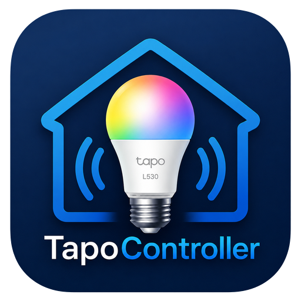
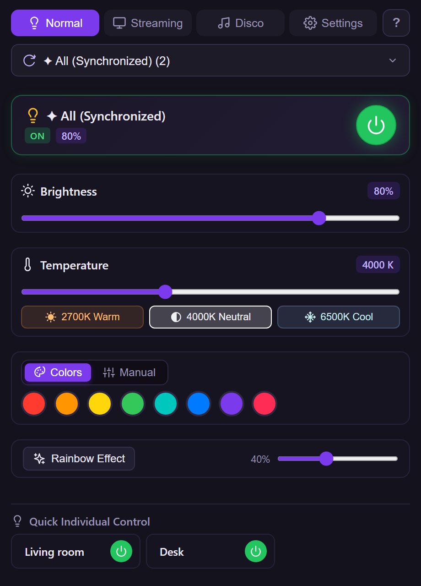
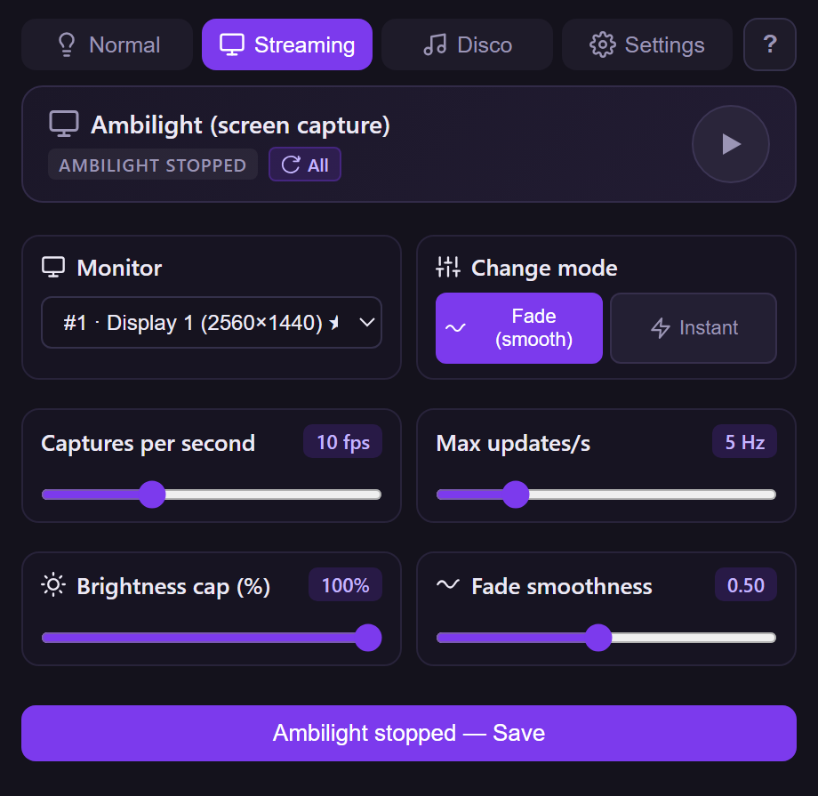
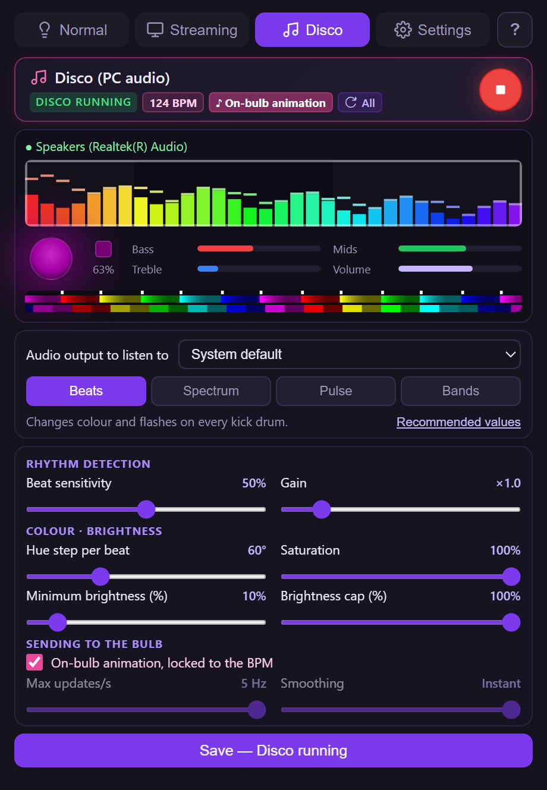
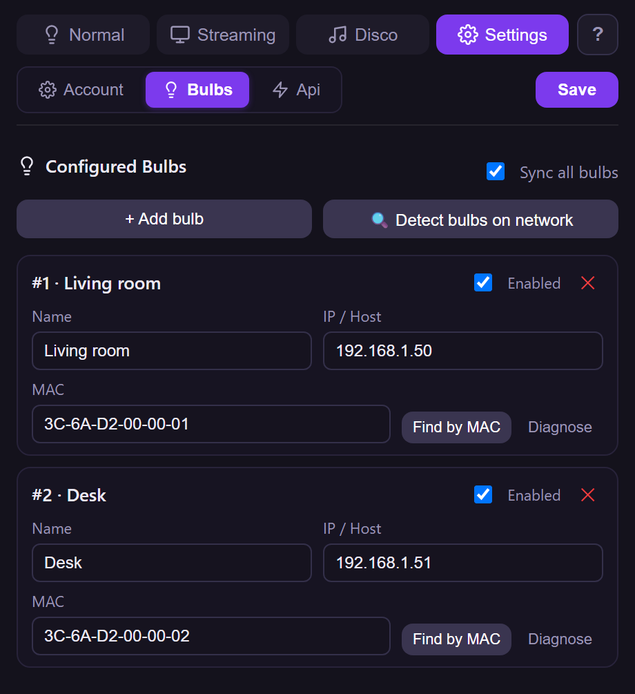

<p align="center">
  
</p>

<h1 align="center">TapoController</h1>

**100% local control (no cloud) of TP‑Link Tapo L530 smart bulbs** — a desktop
app (Tauri 2 + React) with its own reverse‑engineered implementation of the
Tapo local protocol (KLAP). It drives one or several bulbs at once and adds three
light effects:

- **Ambilight**: the bulb follows the colours on your screen. It works with
  PotPlayer, VLC, games or anything else on that monitor.
- **Disco**: the bulb dances to whatever your PC is playing, with a live
  preview for tuning.
- **Rainbow**: a smooth colour cycle that the bulb runs by itself.

A local API lets plugins and automations control it too.

No third‑party SDK and no TP‑Link cloud during operation: every command goes
straight to the bulbs on your LAN. The app finds bulbs on your network by
itself and follows them by MAC address when your router hands out a new IP.

<p align="center">
  
  
  
  
</p>

---

## The bulb

| | |
|---|---|
| Model | **Tapo L530E** (EU SKU reported by the device: `L530EA`) |
| Type | Smart Wi‑Fi LED bulb, multicolor |
| Socket | E27 |
| Light | White **2500–6500 K** + ~16M colors, dimmable |
| Brightness / power | ≈ 806 lm, ≈ 8.7 W (60 W equivalent) |
| Connectivity | 2.4 GHz Wi‑Fi (802.11 b/g/n), **no hub required** |
| Local protocol | **KLAP** over HTTP (firmware "SHIP 2.0", tested on `1.4.x`) |
| Matter | ❌ Not supported by the L530 (the L535E is the Matter model) |

Official product page: **<https://www.tapo.com/en/product/smart-light-bulb/tapo-l530e/>**

Developed and tested on the L530. Other Tapo colour bulbs that speak KLAP
(L510, L535, L610…) will probably work too, but they are untested.

---

## Download & install (Windows)

Grab the latest from **[Releases](https://github.com/alexwing/TapoController/releases/latest)**:

| File | Use |
|------|-----|
| `TapoController-vX.Y.Z-Setup.exe` | Installer (recommended, per‑user, no admin) |
| `TapoController-vX.Y.Z.msi` | MSI installer (deployment/GPO) |
| `TapoController-vX.Y.Z-Standalone.exe` | Single exe, no install — just run it |
| `TapoController-vX.Y.Z-Portable.zip` | App + `tapo-cli` + example config in one folder |
| `tapo-cli-vX.Y.Z-windows-x64.exe` | Command‑line diagnostic tool |

> The binaries are **unsigned**, so Windows SmartScreen shows an
> "unknown publisher" warning the first time → *More info* → *Run anyway*.

Installing a new version over an old one keeps your settings.

### One‑time setup in the Tapo mobile app (Android / iOS)

The bulb only accepts local control after it has been onboarded with the Tapo
app **and** the local API has been enabled there. This is enforced by the
bulb's firmware — there is no software way around it. You only do this **once**.

1. Install **Tapo** ([Android](https://play.google.com/store/apps/details?id=com.tplink.iot) /
   [iOS](https://apps.apple.com/app/tp-link-tapo/id1472718009)) and sign in
   (a free TP‑Link account is required just for setup).
2. **Add the bulb**: tap **+** → *Add Device* → *Bulbs* → follow the pairing
   (the bulb must end up connected to your **2.4 GHz Wi‑Fi**).
3. **Enable local/third‑party access**. Open the app's account tab and turn the
   setting **ON**. The exact label/location varies by app version — look for
   one of these:
   - **Me** (bottom‑right) → **Tapo Lab** → **Third‑Party Compatibility** → ON
   - or **Me** → **Third‑Party Services** / **Local Access** → ON
   - (older builds: Settings → *Allow local control*)
4. Keep the same TP‑Link account credentials handy — you'll enter them once in
   TapoController (they're used only locally to derive the auth hash; never
   sent to any cloud).

> If it was already paired before, you only need step 3. If TapoController's
> **Diagnose** says `KlapGatedOff`, step 3 is not enabled yet (toggle it
> OFF→ON and retry). Tip: after this, block the bulb's internet/WAN access on
> your router so a cloud re‑bind can't disable local access again.

After that, **all control is 100% local** — no cloud, no internet needed.

### First run

1. Open TapoController → **Settings** → **Account**, enter the **e‑mail and
   password of the TP‑Link account** the bulbs are linked to, and **Save**.
2. Go to **Settings** → **Bulbs** → **Detect bulbs on network**. The scan takes
   about a second; add the bulbs it finds (or **+ Add bulb** and type the IP).
3. **Diagnose** on a bulb card checks the connection:
   - `KlapReady` → good.
   - `KlapGatedOff` → you still need to enable Third‑Party Services (above).
   - `Unreachable` → wrong IP / not on the LAN.
4. Settings are stored in `%APPDATA%\TapoController\tapo-config.toml`.

---

## User manual

The app has four tabs: **Normal**, **Streaming**, **Disco** and **Settings**.
The **?** button opens the built‑in help guide. The UI comes in English,
Spanish, German, French and Portuguese, and follows your system language by
default.

### Several bulbs

The selector at the top of the Normal tab chooses what you control:

- **✦ All (Synchronized)** sends every change to all bulbs in parallel.
- Pick a single bulb to adjust it on its own.

**Quick Individual Control** at the bottom of the tab turns each bulb on or off
with one tap. Ambilight and Disco follow the same choice (the *All* pill on their
header).

### Normal tab


- **Power button** — click to toggle; it glows green while the light is on.
- **Brightness** 1–100 %.
- **Temperature** 2500–6500 K, with **2700K Warm / 4000K Neutral / 6500K
  Cool** chips that use the bulb's white LEDs at full output.
- **Colors** — eight preset colours plus an RGB picker. **Manual** shows hue and
  saturation sliders for fine control.
- **Rainbow Effect** — a smooth colour cycle rendered **by the bulb itself**
  (its native dynamic‑effect engine: no flicker, no per‑frame network
  traffic). The slider sets the speed.

### Streaming tab — Ambilight


Captures the average colour of a monitor and pushes it to the bulbs, so the
light matches what's on screen. Player‑agnostic — works with **PotPlayer**,
VLC, browsers, games, anything.

- **Monitor** — which display to sample (★ = primary).
- **Change mode** — **Fade (smooth)** eases between colours (set **Fade
  smoothness**); **Instant** snaps to the screen colour.
- **Captures per second** (1–30) and **Max updates/s** — how often the screen is
  sampled and how often the bulb is updated. The pipeline coalesces and
  rate‑limits, so the bulb is never flooded.
- **Brightness cap (%)** — brightness tracks the scene (dark scene → dim) but
  never exceeds this ceiling.
- **▶** starts/stops; **Save** keeps the settings as defaults.

### Disco tab — music from the PC


Listens to whatever your sound card is playing and makes the bulbs react to it.
It does **not** use the microphone: it captures the audio output directly
(WASAPI loopback), so it also works with headphones.

- **Live preview** — spectrum of what's playing, bass/mids/treble/volume
  meters and a **simulated bulb** that already applies the bulb's real update
  limit. Below it, a 6‑second timeline compares the computed colour (top) with
  what the bulb shows (bottom); white ticks are detected beats.
- **Nothing is sent until you press ▶.** Tune while watching the preview;
  changes apply live and **Save** stores them as defaults.
- **Effects**:
  - **Beats** — changes colour on every kick and flashes.
  - **Spectrum** — colour follows the dominant frequency (red = bass → violet
    = treble).
  - **Pulse** — a fixed colour that throbs with the bass.
  - **Bands** — bass as red, mids as green, treble as blue.
- **Recommended values** sets the selected effect to a known‑good starting
  point. Each effect shows only the settings it uses.
- **On‑bulb animation, locked to the BPM** (Beats and Pulse) — the L530 takes
  ~200 ms to process each colour command, so streaming tops out at ~5 changes
  per second. With this option on, the app tracks the tempo, and once it has
  been stable for 3 s it programs an animation on the bulb itself at that BPM. It
  starts the animation on a beat and re‑aligns it every 16 beats. If the beat is
  lost it falls back to normal streaming. The **♪ On‑bulb animation** tag shows
  when it is active.
- Disco, Ambilight and the rainbow share one channel: starting one stops the
  others.

### Settings tab


- **Account** — TP‑Link e‑mail/password, language, and the help guide.
- **Bulbs** — the bulb list: name, IP, MAC, enable/remove, **Detect bulbs on
  network**, **Find by MAC** and **Diagnose**. **Sync all bulbs** turns
  synchronized control on or off.
  - Each bulb's **MAC** is stored. If the router gives a bulb a new IP, the app
    finds it again on the LAN (ARP) and updates the address on its own.
- **Api** — enable/disable the local API server, bind address and port
  (changing them needs an app restart).

### System tray (Windows)

Closing or minimizing the window sends the app to the **tray** (it keeps
running — API, ambilight and disco included). Tray menu: **Turn on · Turn off ·
Show/Hide · Exit**. Left‑click the tray icon toggles the window.

---

## Local API (for plugins)

With the app running, an HTTP + WebSocket server is available (default
`http://127.0.0.1:7755`). Endpoints: `/health`, `/monitors`, `/bulbs`,
`/active`, `/sync`, `/state`, `/power`, `/brightness`, `/color`,
`/color_temp`, `/white`, `/animation`, and a WebSocket `/stream` for high‑rate
color frames.

Full spec and examples: **[`docs/API.md`](docs/API.md)** ·
sample client: [`examples/ambilight-demo.mjs`](examples/ambilight-demo.mjs).

```sh
curl http://127.0.0.1:7755/health
curl -X POST http://127.0.0.1:7755/power -H 'Content-Type: application/json' -d '{"on":true}'
```

---

## Build from source

Requirements: Rust (stable), Node 18+, and the Tauri prerequisites for your OS.

```sh
npm install
npm run app:dev        # run the desktop app in development (Tauri + Vite)
npm run app:build      # full build: installers (NSIS + MSI) + standalone exe
npm run icons          # regenerate icons from docs/icon.png
cargo test --workspace # run the test suite
```

(`app:dev`/`app:build` are aliases for `tauri dev`/`tauri build`, which run the
Vite dev/build steps automatically.) Pushing a `vX.Y.Z` tag builds and
publishes a GitHub release through `.github/workflows/release.yml`.

Project layout:

```
crates/tapo-proto/   Core: own protocol (KLAP + legacy securePassthrough),
                     raw HTTP client, config, ControlService (session,
                     reconnect, color pipeline, on-bulb effects), diagnostics.
                     examples/fx_probe.rs measures bulb latency and effects.
crates/tapo-cli/     Diagnostic CLI (doctor / info / set / raw …).
src-tauri/           Desktop app: IPC, tray, embedded API server, ambilight
                     (screen capture), disco (WASAPI loopback + FFT + beat
                     and tempo tracking), multi-bulb control.
src/                 React/Vite/TypeScript UI (4 tabs, 5 languages, help guide).
docs/                API spec, screenshots, icon.
scripts/             GitHub release helper.
```

## How it works (reverse‑engineering notes)

- The bulb's embedded **"SHIP 2.0" HTTP server is case‑sensitive on header
  names** and rejects the lowercase headers `hyper`/`reqwest` emit, so
  `tapo-proto` ships its **own raw HTTP/1.1 client** (`http.rs`) with
  Title‑Case headers and `Content-Length`‑delimited reads.
- Each request is sent as **one TCP packet with Nagle disabled**. Sending
  headers and body separately made every command wait ~200 ms for the bulb's
  delayed ACK; fixing it halved command latency.
- Protocol is **KLAP**; `handshake1` needs a random seed and the credential
  hash for this firmware is `sha256( sha1(user) ‖ sha1(pass) )` (auto‑resolved
  against the server hash among known schemes).
- Measured limits on an L530 (fw 1.4.x): a state read takes ~35 ms, but a colour
  change takes **~200 ms** on the bulb and commands are serialized, so about
  **5 colour changes per second** is the ceiling.
- The rainbow and the Disco on‑bulb animation use the bulb's own effect engine:
  `edit_dynamic_light_effect_rule` + `set_dynamic_light_effect_rule_enable`
  (rule "L1", `change_mode` `"bln"` or `"direct"`, 2–8 colour stops, step time
  down to 50 ms). The firmware does the fades.

## License

MIT.
